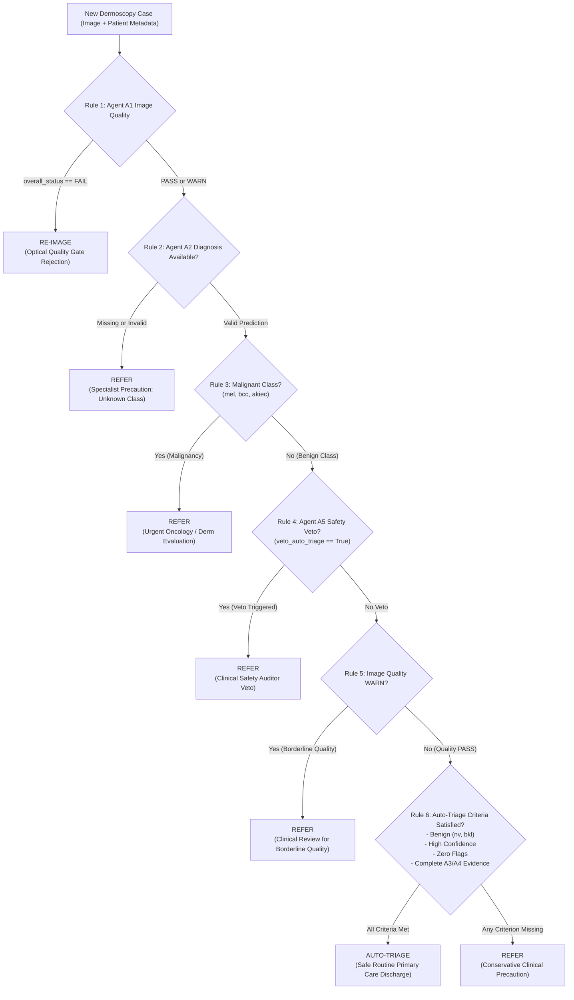

# Agentic DermaGuard: Clinical Decision Policy & Triage Routing Tree

**Policy Version**: `1.0`  
**Governing Agent**: Agent A6 (Coordinator & Triage Engine)  
**Author**: Palak (Integration Owner & Agent A6 Coordinator)  
**Collaborators**: Utsavi (Safety Auditor), Ilka (Diagnosis Lead), Aashi (Clinical Context & UI)  

---

## 1. Clinical Disposition Taxonomy

The Agentic DermaGuard system classifies every evaluated dermoscopy image into exactly one of three authoritative clinical decisions:

| Decision Enum | Clinical Meaning | Target Disposition | Review Obligation |
|---|---|---|---|
| **`AUTO-TRIAGE`** | High-confidence benign lesion on pristine dermoscopy with zero risk indicators. | Standard routine primary care monitoring; no immediate specialist referral. | `requires_review = False` |
| **`REFER`** | Suspected malignancy, pre-malignancy, high clinical risk, border ambiguity, or safety veto. | Urgent or routine specialist dermatology referral for physical dermoscopy and biopsy. | `requires_review = True` |
| **`RE-IMAGE`** | Severe optical artifact (blur, severe glare, illumination dropout, obstruction). | Image rejected before diagnosis; request clear clinical re-capture. | `requires_review = True` |

---

## 2. Deterministic Decision Hierarchy

The coordinator applies an unambiguous, cascading deterministic routing tree. Safety and quality gates strictly precede diagnostic disposition.

---

## 3. Detailed Rule Specifications

### Rule 1: Optical Quality Gate (`RE-IMAGE`)
- **Trigger**: `a1_quality["overall_status"] == "FAIL"`.
- **Clinical Rationale**: Severe optical degradation (e.g. Laplacian blur variance below critical threshold, excessive specular reflections, or hair obstruction) obscures fine diagnostic pigment networks. Diagnosing a degraded image risks catastrophic false-negative melanoma outcomes.
- **Action**: Return `decision = "RE-IMAGE"`, `requires_review = True`.

### Rule 2: Unmapped or Missing Diagnosis (`REFER`)
- **Trigger**: `a2_diagnosis["predicted_class"]` is `None`, `"unknown"`, or not in the 7 canonical classes.
- **Clinical Rationale**: The multi-agent coordinator will **never hallucinate** or silently default to a benign diagnosis like `nv` when the model fails.
- **Action**: Return `decision = "REFER"`, `requires_review = True`.

### Rule 3: Malignant & Pre-Malignant Triage (`REFER`)
- **Trigger**: `predicted_label in {"mel", "bcc", "akiec"}`.
- **Clinical Rationale**: Melanoma (`mel`), basal cell carcinoma (`bcc`), and actinic keratosis (`akiec`) require clinical dermatological evaluation, dermoscopy mapping, and histopathological biopsy.
- **Action**: Return `decision = "REFER"`, `requires_review = True`.

### Rule 4: Clinical Safety Auditor Veto (`REFER`)
- **Trigger**: `a5_safety["veto_auto_triage"] is True` or `a5_safety["safety_flag"] is True`.
- **Sub-triggers**:
  - Secondary melanoma probability $P(\text{mel}) \ge 0.20$.
  - Model confidence below safe threshold ($< 0.60$).
  - High-risk morphology signs detected by A3 (ulceration, atypical pigment network, irregular streaks, blue-white veil).
  - High-risk clinical context detected by A4 (patient age $> 65$ with new/changing lesion, pediatric atypical lesion, prior melanoma history).
  - Unreliable or failed lesion segmentation (`a3["reliable"] is False` or `a3["error"]`).
- **Action**: Return `decision = "REFER"`, `requires_review = True`.

### Rule 5: Borderline Quality Warning (`REFER`)
- **Trigger**: `a1_quality["overall_status"] == "WARN"`.
- **Clinical Rationale**: Images with sub-optimal focus or illumination that pass minimum thresholds but carry warning flags must not be discharged without human clinician sign-off.
- **Action**: Return `decision = "REFER"`, `requires_review = True`.

### Rule 6: Low-Risk Safe Auto-Triage (`AUTO-TRIAGE`)
- **Trigger**: Strictly requires **all** of the following:
  1. `predicted_label in {"nv", "bkl"}` (Melanocytic nevi or benign keratosis).
  2. `a1_quality["overall_status"] == "PASS"` (Verified pristine dermoscopy).
  3. `a5_safety["safety_flag"] is False` and `a5_safety["veto_auto_triage"] is False`.
  4. Both Agent A3 (morphology) and Agent A4 (context) evidence payloads are present and verified.
- **Action**: Return `decision = "AUTO-TRIAGE"`, `requires_review = False`.

### Rule 7: Precautionary Fallback (`REFER`)
- **Trigger**: Any case not cleared by Rule 6 (e.g. vascular lesions `vasc`, dermatofibroma `df`, or ambiguous edge cases).
- **Action**: Return `decision = "REFER"`, `requires_review = True`.
