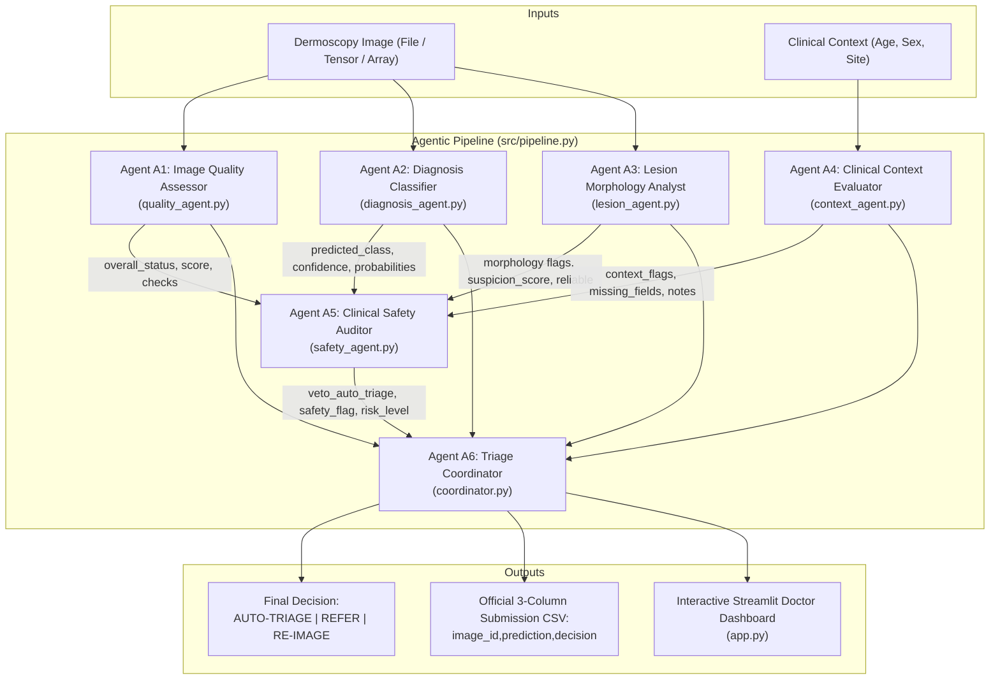

# Agentic DermaGuard: Phase 2 Demo Runbook & Operational Guide

**Project**: JAI 2026 International Agentic AI Hackathon — Healthcare Track  
**System**: Agentic DermaGuard Multi-Agent Skin Lesion Diagnostic & Triage System  
**Lead Coordinator**: Palak (Integration Owner & Agent A6 Coordinator)  
**Target Branch**: `integration/phase2-integration`  
**Version**: `1.0`  

---

## 1. System Architecture: 6-Agent Collaborative Hierarchy

The DermaGuard architecture orchestrates six specialized, independent agents organized in a cascading safety-first decision hierarchy.



---

## 2. Multi-Agent Inter-Agent Contracts

| Agent | Module | Input Contract | Output Contract | Role in Final Triage |
|---|---|---|---|---|
| **A1: Quality** | `src/quality_agent.py` | Image (path / array) | `overall_status` (PASS/WARN/FAIL), `score`, `checks`, `reasons` | Severe optical defect (`FAIL`) triggers mandatory `RE-IMAGE`. |
| **A2: Diagnosis** | `src/diagnosis_agent.py` | Image (path / array) | `predicted_class` (7 classes), `confidence`, `probabilities` | Core multiclass prediction; missing/invalid model output triggers `REFER`. |
| **A3: Lesion** | `src/lesion_agent.py` | Image (path / array) | `suspicion_score`, `reliability`, `reliable`, `flags`, `evidence` | Morphology signs (asymmetry, atypical network) trigger A5 safety veto. |
| **A4: Context** | `src/context_agent.py` | Dict (`age`, `sex`, `site`) | `age`, `sex`, `localization`, `missing_fields`, `context_flags` | High-risk demographics (pediatric/elderly, high-risk site) feed A5 audit. |
| **A5: Safety** | `src/safety_agent.py` | Outputs of A1 to A4 | `safety_flag`, `veto_auto_triage`, `requires_human_review`, `risk_level` | Independent clinical veto authority: overrides auto-triage to `REFER`. |
| **A6: Coordinator**| `src/coordinator.py` | Outputs of A1 to A5 | `predicted_label`, `decision`, `requires_review`, `rationale`, `trace` | Deterministic synthesis into `AUTO-TRIAGE`, `REFER`, or `RE-IMAGE`. |

---

## 3. CLI Execution Guide

### 3.1 Single Image Pipeline Execution
You can execute the entire pipeline programmatically in Python:

```python
from src.pipeline import run_pipeline

# Run single case with patient metadata
result = run_pipeline(
    image_input="path/to/dermoscopy_image.jpg",
    metadata={"age": 58, "sex": "male", "localization": "back"},
    image_id="ISIC_0024306"
)

print(f"Image ID:         {result['image_id']}")
print(f"Prediction:       {result['prediction']}")
print(f"Decision:         {result['decision']}")
print(f"Requires Review:  {result['requires_review']}")
print("Clinical Rationale:")
for r in result["rationale"]:
    print(f"  - {r}")
```

### 3.2 Batch Pipeline & Official Submission CSV Generation
Process a batch of cases and export the official 3-column submission CSV:

```python
from src.pipeline import run_pipeline, generate_submission_csv

cases = [
    {"image": "data/images/ISIC_0001.jpg", "id": "ISIC_0001", "meta": {"age": 62, "sex": "female"}},
    {"image": "data/images/ISIC_0002.jpg", "id": "ISIC_0002", "meta": {"age": 24, "sex": "male"}},
]

results = [
    run_pipeline(c["image"], metadata=c["meta"], image_id=c["id"])
    for c in cases
]

# Generate official submission CSV: image_id,prediction,decision
df_submission = generate_submission_csv(
    results=results,
    output_path="outputs/final_phase2_submission.csv",
    column_name="prediction"
)
print("Submission CSV saved successfully:")
print(df_submission.head())
```

---

## 4. Interactive Streamlit Clinical Dashboard

Launch the clinician review and interactive triage dashboard:

```powershell
streamlit run app.py
```

### Dashboard Capabilities:
1. **Interactive Image Upload**: Drag-and-drop clinical dermoscopy images (.jpg, .png).
2. **Patient Metadata Sidebar**: Enter age, sex, and anatomical localization.
3. **Multi-Agent Diagnostics Panel**:
   - Quality gauge displaying blur, glare, illumination, and obstruction metrics.
   - 7-class probability bar chart with prominent Melanoma risk highlighting.
   - Lesion segmentation mask and morphological ABCD features overlay.
   - Audit trail showing all 5 agent contributions and safety auditor findings.
4. **Authoritative Decision Banner**: Color-coded indicator displaying `AUTO-TRIAGE` (Green), `REFER` (Amber/Red), or `RE-IMAGE` (Blue).

---

## 5. Validation & Metrics Guide

To evaluate model performance and triage safety across a validation cohort:

```powershell
python -m src.evaluate --results-csv outputs/validation_results.csv --metrics-json outputs/metrics.json
```

### Key Clinical Metrics:
1. **Overall Accuracy**: Fraction of total lesions with correctly classified primary diagnostic class.
2. **Balanced Accuracy**: Macro-average of recall across all 7 classes, counteracting the dominant `nv` class imbalance.
3. **Macro-F1 Score**: Harmonic mean of precision and recall across all classes.
4. **Melanoma Sensitivity (Recall)**:
   $$\text{Recall}_{\text{mel}} = \frac{\text{True Melanomas Detected}}{\text{Total Ground-Truth Melanomas}}$$
   *Clinical Safety Guardrail*: Must exceed 70.0% to prevent under-triage of malignant melanoma.
5. **Auto-Triage Disposition Statistics**:
   - `AUTO-TRIAGE Count`: Low-risk cases safely cleared for primary care monitoring.
   - `Auto-Triage False Negative Rate`: Cases auto-triaged that were actually malignant (must be strictly **0.0%**).
   - `REFER Count`: Cases referred for physical dermoscopy and biopsy.
   - `RE-IMAGE Count`: Cases rejected due to optical artifacts before clinical review.

---

## 6. Fallback & Edge Case Troubleshooting

| Failure Scenario | Upstream Behavior | Pipeline Fallback Action | Triage Outcome |
|---|---|---|---|
| **Missing Patient Metadata** | `metadata = None` or empty dictionary. | Agent A4 notes `ALL_CONTEXT_MISSING`. A5 logs missing demographic evidence. | **`REFER`** (conservative clinical precaution). |
| **Severe Optical Artifacts** | Blurred, dark, or hair-covered image. | Agent A1 flags `overall_status = "FAIL"`. Rule 1 triggers immediate quality gate rejection. | **`RE-IMAGE`** (`requires_review = True`). |
| **Missing / Failed ML Model** | Model file absent or inference error. | Agent A2 assigns `predicted_class = "unknown"`. Rule 2 prevents silent defaulting to benign. | **`REFER`** (specialist precaution). |
| **High Secondary Melanoma Risk** | Primary prediction is benign mole (`nv`), but $P(\text{mel}) \ge 0.20$. | Agent A5 detects elevated melanoma probability and issues veto (`veto_auto_triage = True`). | **`REFER`** (safety veto overrides model). |
| **Failed Lesion Segmentation** | Low contrast or uniform background causes A3 failure. | Agent A3 sets `reliability = "LOW"`, `reliable = False`, and emits error string. | **`REFER`** (unreliable evidence veto). |
